# yorozu-fx v1.0 タスク計画

作成日: 2026-11-07 / 計画版: 1 / 根拠: [SPEC.md](SPEC.md) v1.0（基準コミット `f59d3d6ef7827502a486567f2087719011452add`）

## 1. 目的と運用

本書のP01〜P31をそれぞれ1件のGitHub Issueへ起票する。これは開発と評価の実行計画であり、実装・実機試験・画作り・需要検証の合格報告ではない。SPECが正本であり、本計画は仕様範囲や閾値を緩めない。

現状はREADMEと仕様書のみで、実装・ビルド基盤・試験データ・配布物は存在しない。以下のパスは実装時に作る推奨の責務境界であり、既存コードがあるという意味ではない。依存する仕様やデータが不足した場合は、不足物と再開条件をIssueに記録して未完了を維持する。

- 各タスクの「依存」は完了が必要な直接前提。上流ゲート未合格の下流実装へ進まない。環境調達・評価者募集など、独立した準備は先行可能。
- ゲートIssueは実装Issueとは別に、成果物・試験・対象環境を横断確認する。単体テスト成功、片側OS成功、合成データの成功だけでは閉じない。
- 実装Issueは対象の回帰試験と変更レビューまでを完了条件とする。ゲートIssueは実機ログ、画像、設定、配布物等の証拠リンクを追加して初めて完了とする。
- 試験報告には対象commit、engine/pack/mask版、素材hash、設定、OS/Resolve/GPU/driver、実施日、実測値、失敗と未実施を記録する。権利や容量の都合で素材を公開できない場合は、許可された保管先と取得手順を記載し、無断で公開しない。
- 実機・署名証明書・評価者・素材の権利が未確保なら、その取得タスクの未完了を維持する。認証情報・秘密鍵をリポジトリやIssueへ記載しない。
- G1は初期3基底、G2以降は全6基底で判定する。初期3基底はL05/L03/L07とし、G1での承認を最終6基底の承認へ読み替えない。
- SPECの20〜28週はC++/GPU担当1名・色制作担当1名・評価協力者を前提とするフェーズ見積もり。31タスクを1人週ずつと解釈せず、G0で資源・待ち時間・担当を再見積もりする。初版にHDR・AI・12基底・独自カードUIを追加しない。

## 2. フェーズ・依存関係

| フェーズ | タスク | 完了ゲート | SPECの目安 |
| --- | --- | --- | --- |
| G0 ホスト成立性 | P01〜P04 | P05 | 2〜3週 |
| G1 色の成立性 | P06〜P11 | P12 | 4〜6週 |
| G2 商品の核 | P13〜P15 | P16 | 4〜5週 |
| G3 再利用 | P17〜P21 | P22 | 4〜6週 |
| G4 ベータ・商品検証 | P23〜P25 | P26 | 3〜4週 |
| G5 出荷 | P27〜P30 | P31 | 3〜4週 |

```mermaid
flowchart LR
  P01 --> P03
  P02 --> P03
  P03 --> P04
  P04 --> P05
  P02 --> P05
  P05 --> P06
  P06 --> P07
  P07 --> P08
  P08 --> P09
  P09 --> P10
  P10 --> P11
  P11 --> P12
  P12 --> P13
  P13 --> P14
  P14 --> P15
  P15 --> P16
  P16 --> P17
  P17 --> P18
  P18 --> P19
  P19 --> P20
  P20 --> P21
  P21 --> P22
  P22 --> P23
  P23 --> P24
  P24 --> P25
  P25 --> P26
  P26 --> P27
  P27 --> P28
  P27 --> P29
  P28 --> P30
  P29 --> P30
  P30 --> P31
```

図は主な進行経路。各タスクの直接依存一覧を正とする。P01/P02は並行可能。P08のターゲット制作とP09の合成データによる試作は並行準備できるが、P09完了には実パックが必要。P28/P29も並行可能。評価者募集と署名サービスの調達はP02から先行し、P25/P28まで放置しない。

## 3. タスク詳細

### P01 — C++/OFXのビルド基盤とホスト非依存CIを作る

- フェーズ: G0 / 種別: implementation / リスク: 中 / 依存: なし
- 根拠: SPEC §10.1、FR-HOST-01、§14 G0
- 責務・成果物: `CMakeLists.txt`、`src/core/`、`src/ofx/`、`tests/`、`.github/workflows/`、`docs/DEVELOPMENT.md`。SDK・依存版・ライセンスを固定し、macOS/Windowsのネイティブ構成とテスト起動手順を用意する。ここでの最小OFXはビルド確認用stubとし、パラメータ・保存・Undo付きのホスト試作はP03へ分ける。ビルドツールの具体版はこのタスクで決定して記録する。
- 受入条件: 両OSのクリーンcheckoutで最小OFXをビルドでき、CPUテストをCIで実行できる。SDKを再配布できない場合は許可された取得手順とライセンスを示す。標準CIにResolveやCUDA実機試験があると装わず、コンパイル検証と実機試験を分ける。
- 検証: クリーンビルド、CPUスモークテスト、依存版再現、失敗時のCI終了コード。CI報告とホスト実測は別成果物。

### P02 — 実機マトリクス・素材権利・評価資源を確保する

- フェーズ: G0 / 種別: preparation / リスク: 高 / 依存: なし
- 根拠: SPEC §5.1、§12.2/12.3、§13、§14
- 責務・成果物: `docs/validation/environment-matrix.md`、資源/権利台帳。macOS Apple Silicon/MetalとWindows x64/NVIDIA CUDA、それぞれStudio 20/21の試験パッチ版・OS・driver・機種を固定する。色制作担当、専門家2名、被験者8名以上、素材調達、署名/公証・Windows署名の取得担当と予定を記録する。
- 受入条件: 4ホスト組合せへ実際にアクセスできることを確認し、性能基準機または事前承認した同等機を特定する。素材の使用/保管/公開条件と評価協力・署名の調達見通しを記録する。購入や招待等の外部行為は別途その時点の権限に従う。未確保項目は未確保と記録し、G0に必須の実機不足があれば閉じない。
- 検証: 実機の版情報・起動確認、権利台帳、各準備項目の担当・期限・再開条件。秘密情報は記載しない。

### P03 — 最小OFXでパラメータ保存・Undo・ファイル操作を実証する

- フェーズ: G0 / 種別: spike / リスク: 高 / 依存: P01, P02
- 根拠: SPEC FR-UI-02/03、FR-SAVE-01/02、FR-REC-02、§14 G0
- 責務・成果物: `src/ofx/`、`tests/host/`、`docs/validation/g0-host.md`。CPUパススルーOFX、標準数値/choice/button/string、非アニメーション値、保存/再読込、編集グループ、ファイル操作キャンセルを試作する。
- 受入条件: 全対象ホストで挿入・変更・保存・再起動・Undo/Redoが動く。ファイル選択が使えなければパス欄＋明示実行ボタンの代替を実証する。独自InteractやScripting APIを必須にしない。試作用IDと出荷用IDを区別し、最終IDはP14で固定する。
- 検証: 実Resolveの操作ログ/DRPと再現手順。P17の最終互換性試験をこの試作だけで代替しない。

### P04 — Metal/CUDA受渡しとRGBAパススルーを実機で実証する

- フェーズ: G0 / 種別: spike / リスク: 高 / 依存: P03
- 根拠: SPEC FR-HOST-01/03/04、T12、§14 G0
- 責務・成果物: `src/gpu/metal/`、`src/gpu/cuda/`、OFX受渡し層、GPU成立性報告。バッファ、ストライド、render window/scale、ホスト宣言によるalpha状態、CPU経路選択、GPU失敗通知を確認する。
- 受入条件: 全対象ホストでCPU/MetalまたはCPU/CUDAの有限RGBAパススルーが一致する。オフセット窓・タイル・透明境界で越境や破損がない。GPU失敗を成功扱いせず、同一レンダー途中でCPUへ混在フォールバックしない。
- 検証: 実ホスト入力/出力の比較、失敗注入、各対象GPUのログ。ここでは色kernelの最終T05合格は要求せずP11/P12で行う。

### P05 — G0ゲート: 両OS・両Resolve版のホスト成立性を判定する

- フェーズ: G0 / 種別: gate / リスク: 高 / 依存: P01, P02, P03, P04
- 根拠: SPEC §14 G0
- 責務・成果物: `docs/validation/gates/G0.md`。基準commit、実機マトリクス、ビルド/ロード/保存/再読込/Undo/ファイル操作/GPU受渡しの証拠と資源見積もりを集約する。
- 受入条件: 4ホスト組合せすべてで成立し、G1用実機・色制作担当が利用可能。片側OSのみ、コンパイルのみ、未実施を合格へ読み替えない。失敗時は原因・再開条件を残して未完了とし、G1以降へ進めない。
- 検証: P01〜P04の証拠を照合しGo/No-Goを記録。準備段階の需要仮説を実測結果と扱わない。

### P06 — 評価素材・出力変換・誤差測定の基準を固定する

- フェーズ: G1 / 種別: validation-foundation / リスク: 高 / 依存: P05
- 根拠: SPEC §12全体、T05〜T07/T10/T16、§14 G1
- 責務・成果物: `tests/fixtures/`、`tests/reference/`、`docs/validation/corpus.md`、版固定したCST/RCMテストプロジェクト。権利確認した30クリップ以上の代表静止画と動きのある10クリップ以上、チャート/ランプ/10万点セット、素材hashと保管条件を揃える。
- 受入条件: DWG/DI→Rec.709 Gamma 2.4の参照変換、Resolve版、トーン/色域マッピング、レンジ、ΔE_OK定義を固定する。開発用点と独立検証点を分離し、表示域外点の割合と符号化値誤差も記録する。許諾未確認の素材を公開しない。
- 検証: 同じ入力/設定から基準を再生成できる。色差の表示域内判定と、域外を除外した件数の報告ができる。G1の評価に必要な実素材がなければ合成チャートだけで閉じない。

### P07 — float64色変換参照と版固定の数値契約を実装する

- フェーズ: G1 / 種別: implementation / リスク: 高 / 依存: P06
- 根拠: SPEC FR-ENG-04/05/06、§9.2、T01/T03/T05/T06
- 責務・成果物: `src/core/color/`、`tests/reference/color/`。DIの公式正逆変換・低値分岐、linear DWG↔XYZ D65↔OKLab、符号保持立方根、float64参照、単位/定数/行列の版を固定する。
- 受入条件: 負値・黒・白・1超・分岐境界で有限に動き、sRGB行列をDWGへ直接使わない。非有限値はバイパスを含む全経路で明示エラーとし、有限値の無効果時は元RGBAを保持できる設計とする。出力ODTやハードクリップを追加しない。
- 検証: 公式既知値、往復、境界、NaN/Infの試験。CPU参照が製品経路と独立して誤差の物差しになることを確認する。

### P08 — 初期3基底とパック契約・制作ツールを作る

- フェーズ: G1 / 種別: look-production / リスク: 高 / 依存: P06, P07
- 根拠: SPEC FR-LOOK-01/02/03、FR-ENG-01、§8、§14 G1
- 責務・成果物: `assets/look-packs/`、`tools/look-authoring/`、`docs/validation/looks/`。L05/L03/L07の独自ターゲットと65³ float32残差データを作る。格子[-0.1,1.1]、走査順、四面体分割規則、pack/schema/hash/著作権を固定する。
- 受入条件: 各ターゲットと基底データを色制作担当が承認し、hash・版・入力空間と権利を追跡できる。不正サイズ・非有限値・hash不一致を拒否する検査を用意する。自作ルックと実在フィルム再現を混同せず、同一ルックの色相違いだけで代替しない。
- 検証: パック再生成/hash検査、格子上のターゲット照合。混合・保護後の視覚承認はP12で行うため、本タスクと循環させない。

### P09 — 残差LUT混合・範囲外ゲート・CPU製品経路を実装する

- フェーズ: G1 / 種別: implementation / リスク: 高 / 依存: P07, P08
- 根拠: SPEC FR-MIX-01/02/03、FR-ENG-01/02/03/06、T01/T02/T05/T06
- 責務・成果物: `src/core/mixer/`、`src/core/lut/`、対応テスト。lookId集約・ID順合算、比率正規化、共通格子の先行合成、四面体補間、[-0.2,-0.1]/[1.1,1.2]のゲート、float32製品CPU経路を作る。
- 受入条件: 元入力をクリップせず、全ゼロ/Strength=0等の無効果はビット一致する。単独1/100、比例配分、重複ID、枠入替はT02の1e-6以内。全ゼロ境界の既知不連続以外は連続で、範囲外は仕様の恒等へ戻る。
- 検証: T01/T02/T06、先行合成対画素ごとの加重和、CPU参照対float32を10万点で比較。P11のGPU検証をここで完了扱いしない。

### P10 — 色/トーン分離と保護・診断マスクを実装する

- フェーズ: G1 / 種別: implementation / リスク: 高 / 依存: P09
- 根拠: SPEC §9.2/9.3、FR-PROT-01/02、FR-UI-01、T03/T04/T06/T07
- 責務・成果物: `src/core/protection/`、ポイント処理パイプライン、マスク試験。Lとa,bの差分、入力基準のNeutral/Skin/Custom、max合成、低クロマ時の色相無効、Custom Preserve Toneを実装する。
- 受入条件: Color/Tone=0、マスク中心100%保護は該当Lab成分1e-5以内。Neutralは既存色かぶりを修復しない。診断は入力マスクを出力し、Strength=0等より優先する。肌検出や物体認識と称さない。
- 検証: T03/T04/T06、マスク境界・重なり・360°跨ぎ、実肌/木材/夕景の誤保護とランプ。最終標準UIはP14へ分離する。

### P11 — 本色処理のMetal/CUDA統合と不変キャッシュを実装する

- フェーズ: G1 / 種別: implementation / リスク: 高 / 依存: P04, P10
- 根拠: SPEC FR-HOST-01〜04、FR-ENG-02、T05/T12/T13/T14
- 責務・成果物: `src/gpu/`、`src/ofx/render/`、キャッシュ/経路試験。P09/P10のポイント処理を両GPUで動かし、pack hash/weight/engine版に紐づく不変合成LUTをレンダーへ渡す。
- 受入条件: 初期3基底・代表混合でCPU/Metal/CUDAがT05のDWG/DI最大1e-4、ΔE_OK最大0.1以内。alphaの分離/再合成と極小alpha保持、無効果RGBAビット一致、複数インスタンスの隔離を満たす。render actionでI/O・候補生成・設定変更・通信をしない。
- 検証: 実機T05/T12/T13とGPU失敗注入。古い設定のキャッシュが新設定へ混入しないことを試験。CPUへの再実行は開始時点で固定し混在させない。

### P12 — G1ゲート: 初期3基底の数値・視覚品質を承認する

- フェーズ: G1 / 種別: gate / リスク: 高 / 依存: P06, P07, P08, P09, P10, P11
- 根拠: SPEC §14 G1、§12.1 T01〜T07、§12.2
- 責務・成果物: `docs/validation/gates/G1.md`、3基底の黄金画像/数値レポート。全ホスト/GPUでT01〜T07、負値/明部/露出±4EV、保護境界・誤保護を確認する。
- 受入条件: 規定閾値をすべて満たし、専門家2名以上が初期3基底の単独・2色配合・3色均等を承認。重大な緑化・蛍光化・階調反転・段差が残れば未合格。仕様閾値を満たせない場合は修正/仕様改訂を明示し、UIを広げて迂回しない。
- 検証: 版固定の実素材・参照出力・各バックエンドレポートを照合。G2用の最終6基底が未作成であることを明記する。

### P13 — 最終6基底と全配合の画作りを完成する

- フェーズ: G2 / 種別: look-production / リスク: 高 / 依存: P12
- 根拠: SPEC §8、FR-LOOK-01〜03、§12.2
- 責務・成果物: L06/L09/L12追加、初期3基底を含む版付き6基底パック、ターゲット、権利/hash台帳、全配合評価表。
- 受入条件: 単独6種、2基底15組×25/50/75%、3基底20組均等を作成し、§12.2の実素材で専門家2名以上が承認する。保護ON/OFFとColor/Tone端点/中間値も評価する。重大欠陥を残して6つ揃ったとしない。
- 検証: 全6基底でT05/T07と視覚回帰。G1の承認後に初期基底が変わった場合は影響範囲を再評価して版を更新する。

### P14 — 3枠ミキサー・全標準UI・診断警告を完成する

- フェーズ: G2 / 種別: implementation / リスク: 中 / 依存: P13
- 根拠: SPEC §7.1/7.2、FR-UI-01〜03、FR-COL-01〜03、FR-SAVE-02
- 責務・成果物: `src/ofx/parameters/`、`resources/i18n/`、標準UI試験。Base/Accent/Finish、比率・ロック・分離・全保護項目、DWG/DI配置案内、診断モードと警告、Resetを用意する。出荷用pluginIdentifier・パラメータID・choice対応を固定する。
- 受入条件: 日本語/英語、範囲・既定値・有限値・非アニメーション指定がSPECと一致。Strength既定0、weight100/0/0。診断ONは実出力へ反映し常時警告、保存再読込後も警告。未実装ボタンを使用可能に見せない。
- 検証: 全4ホストで値編集/リセット/診断/保存とT15の当該部分。独自カード・独自Undo・スポイトを追加しない。候補ボタンはP15、Recipe/LUT操作はP18/P19で接続する。

### P15 — 決定的な3候補生成と候補セッションのUndoを実装する

- フェーズ: G2 / 種別: implementation / リスク: 中 / 依存: P14
- 根拠: SPEC FR-EXP-01〜04、FR-UI-02、T08/T15
- 責務・成果物: `src/core/exploration/`、ホスト候補操作、PCG32既知ベクトル。PRNG/seed初期化と候補→枠順、32回再試行、合計Wを保つ未ロック比率再配分、原本/3候補永続化を実装する。
- 受入条件: 同seed完全一致、lookId/保護/強度/ロックの生weightと配分不変。ゼロ合計、未ロック1つ以下、Amount0、上限超過の再試行枯渇は仕様の元配分と案内を返す。手動変更で古い候補を無効化し、候補適用/復元では原本を上書きしない。
- 検証: T08/T15、候補間移動・再起動・Undo/Redo・生成後編集。確定weightを正本として保存し、フレームごとに再抽選しない。

### P16 — G2ゲート: 6基底・標準操作・候補探索を承認する

- フェーズ: G2 / 種別: gate / リスク: 高 / 依存: P13, P14, P15
- 根拠: SPEC §14 G2、§7/8/12.2
- 責務・成果物: `docs/validation/gates/G2.md`。全配合、6基底での数値/GPU再照合、標準UI・診断・候補操作の実機レポートを集約する。
- 受入条件: P13の視覚承認とP14/P15のホスト操作が全対象環境で合格。単独だけの承認や片側言語/OSのみでは閉じない。レシピ/LUTの未提供状態は明示し、G3完了と誤認させない。
- 検証: T01〜T08、T12/T13/T15の実装済み範囲を全6基底へ拡張して照合する。

### P17 — 全状態の永続化とエンジン/パック互換性を実装する

- フェーズ: G3 / 種別: implementation / リスク: 高 / 依存: P16
- 根拠: SPEC FR-SAVE-01〜03、FR-HOST-02、T09/T13/T14/T15
- 責務・成果物: `src/core/versioning/`、`src/ofx/state/`、旧版回帰fixture。設定・候補セッション・診断・engine/pack/hashをホストパラメータから復元し、旧版評価器/資産の保持契約を実装する。
- 受入条件: 再起動・別マシン・ノード複製・DRP移送で画がT05内に復元。未知/欠落engine・pack・hashは無言置換せず失敗。ID/choice番号の互換性を維持する。出荷前版を固定した旧版fixtureで移行を試験し、存在しない販売済み版を捏造しない。
- 検証: T09/T13/T14/T15、複数インスタンス、旧版状態、欠落/破損、明示アップグレードと復元。

### P18 — レシピJSON・正規形hash・差分・原子的入出力を実装する

- フェーズ: G3 / 種別: implementation / リスク: 高 / 依存: P17
- 根拠: SPEC §11.1、FR-REC-01/02、FR-UI-02、T09/T14/T15
- 責務・成果物: `schemas/recipe-v1.schema.json`、`src/core/recipe/`、OFXファイル操作、`docs/recipe-format.md`。キー順/数値表記を含む正規化プロトコルとhash試験ベクトルを固定し、同スキーマの組込みプリセットを用意する。
- 受入条件: 1MiB上限、必須項目/3枠/有限値/範囲/enum/schema/pack hashを変更前に検証。素材パス・任意shader・コードを扱わない。Compareで数値差を表示し、Importは1Undoで一括適用、キャンセル/失敗で元設定を保持する。Exportは一時ファイルから置換し既存ファイルを保護する。
- 検証: 正規形の往復、実hash、未知版/過大/壊れたJSON/書込不可/キャンセル、別マシン読込とホストUndo。SPECのプレースホルダーhashを実ファイルへ出力しない。

### P19 — LUT生成・両補間誤差検証・メタデータ出力を実装する

- フェーズ: G3 / 種別: implementation / リスク: 高 / 依存: P18
- 根拠: SPEC FR-LUT-01〜05、T10、§12.3 LUT性能
- 責務・成果物: `src/core/export/`、`tests/lut/`、cube/recipe/metadataの出力例。通常ポイント処理の固定設定から33/65格子を生成し、10万点＋重点ランプで三線形/四面体を個別検証する。
- 受入条件: DWG/DI 0〜1入力、R最速、9桁以上、出力負値/1超を保持。両方式でΔE_OK p95≤1/最大≤3、全点DWG/DI最大≤0.01。33不合格で65案内、65不合格時は検証済みcubeを保存せずレポートのみ。診断ONでは生成拒否。出力フォルダーは失敗・キャンセル時に完成品に見える部分結果を残さない。
- 検証: T10、不正/診断/失敗/設定変更中の出力スナップショット、metadataの版/hash/点seed/空間/領域/参照変換/誤差。入力0〜1外のホスト外挿を保証に含めない。

### P20 — ResolveでOFX対LUT・RCM対CSTを実照合する

- フェーズ: G3 / 種別: validation / リスク: 高 / 依存: P19
- 根拠: SPEC FR-COL-01〜03、FR-LUT-02、T11/T16
- 責務・成果物: `tests/host/projects/`、`docs/validation/lut-host-parity.md`。同一ノード位置でOFX/cubeをfloat画像へレンダーし、固定したRCMと手動CSTで比較する。
- 受入条件: 全対象環境でT11のLUT閾値とT16のT05閾値に合格。cubeの負値/1超**出力**保持を実測し、クリップする経路は互換として扱わない。入力0〜1外を合格対象へ混ぜない。誤配置/二重ODTの再現例と回避手順を作る。
- 検証: 格子点以外の10万点、重点ランプ、素材、同一変換設定の実レンダーと差分。CSTとRCMの設定差をエンジン誤差へ混同しない。

### P21 — 障害回復・alpha・並列・ホスト操作を横断回帰する

- フェーズ: G3 / 種別: validation / リスク: 高 / 依存: P17, P18, P19, P20
- 根拠: SPEC FR-HOST-01〜04、T08〜T16
- 責務・成果物: `tests/integration/`、`tests/host/`、`docs/validation/g3-regression.md`。実装済みの候補・永続化・レシピ・LUTを含む障害/並列/alpha試験を整備し、不具合を修正する。
- 受入条件: T08〜T16全項目に実測証拠があり、GPU失敗、書込失敗、未知版、キャンセル、並列ノード、任意シーク、タイル/render scale、premultiplication境界、診断の保存/警告/生成拒否が仕様どおり。偽成功・状態混入・既存データ破壊がない。
- 検証: 全4ホストでの回帰。T10/T11/T16はP19/P20の同commit証拠を再利用できるが、関連修正後は影響分を取り直す。

### P22 — G3ゲート: 再利用と色管理の全契約を承認する

- フェーズ: G3 / 種別: gate / リスク: 高 / 依存: P17, P18, P19, P20, P21
- 根拠: SPEC §14 G3、T08〜T16
- 責務・成果物: `docs/validation/gates/G3.md`、移送可能なレシピ/cube/レポートと互換表。
- 受入条件: 旧版保存、別マシン復元、失敗時不変、両補間誤差、Resolve実照合、色管理がすべて合格。65でも誤差未達のレシピを正式互換として出荷しない。対象実装・パック・レポートのhashを一致させる。
- 検証: P17〜P21の証拠とT08〜T16を照合。単にファイルが生成できることをゲート合格にしない。

### P23 — UHD性能・操作応答・メモリ・長時間安定性を満たす

- フェーズ: G4 / 種別: performance / リスク: 高 / 依存: P22
- 根拠: SPEC §12.3、FR-HOST-02/04
- 責務・成果物: `tools/benchmark/`、`docs/validation/performance.md`。基準機と全対象環境で測定し、必要な最適化と回帰試験を行う。
- 受入条件: 基準機でUHD p95≤20ms/1000フレーム、24fps/60秒CMS起因ドロップなし、操作応答p95≤100ms、追加メモリ≤256MiB、33/65出力＋両補間10万点検証≤10/30秒、1時間の継続メモリ増加/クラッシュなし。複数インスタンスのキャッシュ上限も記録する。
- 検証: warmup・電源モード・コーデック/I/Oとの分離・無適用基準・CPU低速表示を記録。最適化後にT01〜T16の影響試験を再実行し、画質と閾値を緩めない。

### P24 — 日英利用ガイド・配置例・復旧手順・対応表を作る

- フェーズ: G4 / 種別: documentation / リスク: 中 / 依存: P23
- 根拠: SPEC §5〜7、FR-PROT-02、FR-COL、§10.3/11/14 G4
- 責務・成果物: `docs/user-guide/`、`docs/compatibility.md`、README更新。試験済みのClip/Group Post-Clip配置、RCM/CST、保護の限界、診断焼込み注意、レシピ/旧版、LUT領域/誤差、CPU再実行、欠落版の回復を日英で案内する。
- 受入条件: 標準比較・共有ルック・ショット個別補正を実機手順で再現でき、実測済みと目標を区別する。Shared Node/Remote Gradeは試験に合格した手順のみ。未対応環境/HDRを対応済みと見せない。§13の操作課題をガイドで実施可能にする。
- 検証: 日英ガイドの手順実行・リンク・UI名称照合。P28の最終インストール手順は後続で追記し、未完成と区別する。

### P25 — 8名以上の比較操作・画質採用・価格意向を測る

- フェーズ: G4 / 種別: user-study / リスク: 高 / 依存: P23, P24
- 根拠: SPEC §13.1/13.2、I01
- 責務・成果物: `docs/validation/user-study.md`、匿名化した集計、課題/説明資料。被験者8名以上が2ルック混合・肌/商品色保護・6ショット展開・設定保存を行う。標準ノードを全員の比較対象とし、既存購入者には普段の競合も比較してもらう。
- 受入条件: 説明10分、順序交互、同じ素材/習熟条件で、時間比中央値25%以上短縮、支援なし完了80%以上、保護修正回数中央値が比較以下、8名中6名以上の案件採用可、仮価格12,800円で8名中4名以上の購入検討。参加者数が8を超える場合も事前に採用/意向の集計基準を固定し、結果に合わせて変更しない。
- 検証: 誤配置も失敗として数え、品質低下での時間短縮を除外。未達は未達としてG4を止め、仮説/操作/基底を再検討する。合成人物・想定回答を実測へ置換しない。結果の公開範囲は同意条件に従う。

### P26 — G4ゲート: 品質・性能・商品価値を判定する

- フェーズ: G4 / 種別: gate / リスク: 高 / 依存: P23, P24, P25
- 根拠: SPEC §12/13、§14 G4
- 責務・成果物: `docs/validation/gates/G4.md`、ベータ版commit/資産/対応表、未解決一覧、最終見積もり。
- 受入条件: G0〜G3の有効な証拠、§12全品質/性能、§13の操作/需要基準が揃う。優位性を広告へ出す前に根拠と限界を確認する。未達なら正式版へ進まず、限定ベータ/価格/対象の変更は仕様改訂として明示する。
- 検証: 同じベータ版の実装・画作り・評価結果を照合。後続ライセンス/配布変更による再試験はP30で行う。

### P27 — オフラインライセンスと明示的失敗動作を実装する

- フェーズ: G5 / 種別: implementation / リスク: 高 / 依存: P26
- 根拠: SPEC §10.3、§13.2
- 責務・成果物: `src/licensing/`、公開可能なライセンス形式/運用文書、ローカルライセンス読込・検証。発行処理は色エンジンから分離し、販売基盤そのものは作らない。
- 受入条件: 正常なライセンスで完全オフラインの編集/保存/レンダーが可能。欠落/破損は明示エラーで、無言の透かしや偽成功なし。render actionでディスクI/O/通信をしない。1ユーザー2台・OS移行の想定を満たす検証/移行手順を定義する。秘密鍵を配布物へ入れない。
- 検証: ネットワーク遮断、再起動、ライセンス差替え/破損/欠落、別OS移行、レンダー中更新なし。販売条件の確定はP29、完成品の回帰はP30で行う。

### P28 — 署名・公証済みインストーラーと更新/復旧手順を作る

- フェーズ: G5 / 種別: packaging / リスク: 高 / 依存: P27
- 根拠: SPEC §10.3、§14 G5
- 責務・成果物: `packaging/macos/`、`packaging/windows/`、署名/公証用手順、署名済み配布物・hash・インストール/アンインストール/手動更新ガイド。ビルド版と同梱パック/旧版資産/文書を固定する。
- 受入条件: macOSで署名・公証、Windowsでインストーラー署名を実施・検証し、クリーンな対象環境でロードできる。ユーザー操作による更新と旧版復旧で既存設定を壊さない。署名サービス未確保なら未完了。署名されたことだけでG5合格にしない。
- 検証: 実配布物の署名/公証結果、hash、インストール/更新/削除と既存DRP再読込。認証情報をログへ出さない。

### P29 — 権利表記・販売条件・ライセンス発行/サポート運用を確定する

- フェーズ: G5 / 種別: release-operations / リスク: 高 / 依存: P26, P27
- 根拠: SPEC §10.3、§13.2、§14 G5
- 責務・成果物: `docs/release/commercial-readiness.md`、第三者ライセンス/素材権利/名称確認、最終価格と利用条件、ライセンス発行/再発行/移行/復旧/問合せ手順。実際の契約や販売設定変更はその時点の権限に従う。
- 受入条件: 税・サポート費用・権利を確認し、12,800円が仮説か最終価格か明確にする。買い切り/v1.x更新/2台/OS移行/オフライン動作が実装と一致。未定なら未定のまま出荷を止める。未提供体験版・Lite/Pro・クラウド・課金機能を追加しない。
- 検証: ライセンス試験発行〜移行/復旧の手順実証、配布文書との整合、秘密情報と未許諾素材の非混入。

### P30 — 署名済み最終配布物で全出荷回帰を実施する

- フェーズ: G5 / 種別: release-validation / リスク: 高 / 依存: P28, P29
- 根拠: SPEC T01〜T16、§12全体、§14 G5
- 責務・成果物: `docs/validation/release-candidate.md`。P28の実配布物を全対象環境へ入れ、最終commit・pack/mask/engine版・インストーラーhashで試験する。
- 受入条件: T01〜T16、全配合視覚試験、§12.3性能、オフラインライセンス/移行/旧版復旧を最終物で合格。過去報告は同一成果物で有効と証明できるものだけ再利用。ライセンス等の後続変更が操作試験へ影響した場合は§13の影響部分を再検証する。
- 検証: 両OS/両Resolve版の最終適合表と未実施ゼロ。未合格をリリースノート記載だけで許容しない。不具合修正後は再署名・hash更新・影響試験をやり直す。

### P31 — G5ゲート: v1.0出荷判定とリリース記録を完成する

- フェーズ: G5 / 種別: gate / リスク: 高 / 依存: P30
- 根拠: SPEC §14 G5、§5.1、§10.3
- 責務・成果物: `docs/validation/gates/G5.md`、最終リリースノート、公開対象の配布物/hash/対応表/移行手順。公開処理はその時点のリリース権限に従う。
- 受入条件: G0〜G4とP27〜P30の全必須条件が合格し、最終commit/タグ/配布物/hashが一致する。公開する場合は実際の公開先で配布物を取得・照合して完了とする。出荷許可/必須証拠が揃わなければ「出荷待ち」の未完了。限定ベータを正式v1.0と呼ばない。
- 検証: 公開状態、実配布物、署名、版、証拠索引を確認。ローカルcommit、CI緑、ドラフトリリースだけで閉じない。

## 4. 要件・試験の担当対応

実装担当は試験を先送りせず各Issueで実行する。右列は最終横断証拠の責任タスクであり、重複実装を指示するものではない。

| 要件/試験 | 実装・準備の主担当 | 横断承認 |
| --- | --- | --- |
| FR-COL-01〜03 / T16 | P06, P14, P20, P24 | P22, P30 |
| FR-UI-01〜03 / T15 | P03, P10, P14, P15, P18, P19 | P21, P22, P30 |
| FR-MIX-01〜03 / T01/T02 | P09, P11, P14 | P12, P16, P30 |
| FR-EXP-01〜04 / T08 | P15, P17 | P16, P21, P30 |
| FR-LOOK-01〜03 / T07 | P08, P13 | P12（3基底）, P16（6基底）, P30 |
| FR-ENG-01〜06 / T03/T05/T06 | P07〜P11 | P12, P16, P30 |
| FR-PROT-01/02 / T04 | P10, P13, P24 | P12, P16, P30 |
| FR-HOST-01〜04 / T12/T13 | P04, P11, P17, P23 | P05（成立性）, P21, P30 |
| FR-SAVE-01〜03 / T09 | P03, P14, P17 | P21, P22, P30 |
| FR-REC-01/02 / T14 | P18 | P21, P22, P30 |
| FR-LUT-01〜05 / T10/T11 | P19, P20 | P22, P30 |
| §12.2 視覚 | P06, P08, P13 | P12, P16, P30 |
| §12.3 性能 | P02, P11, P23 | P26, P30 |
| §13 操作/需要/価格 | P02, P24, P25, P29 | P26, P31 |
| §10.3 配布/オフライン | P02, P27〜P29 | P30, P31 |

## 5. レビューとIssue台帳

起票前に独立サブエージェントが仕様カバレッジと依存関係/完了判定をレビューする。指摘・修正・再レビュー結果は [TASK_PLAN_REVIEW.md](TASK_PLAN_REVIEW.md) へ保存する。未解決の実行阻害指摘が0になってから起票する。

起票前に既存Issueを全状態で確認し、既存0件から31件を起票した。各Issue本文へSPECの基準版、計画ID、直接依存Issue、成果物、受入条件、検証、未確保条件を記載した。Gate Issueと将来候補の区別を保ち、不採用/保留機能の実装Issueは作成していない。

起票確認日: 2026-11-07。31件すべてOPENであり、実装・ゲート評価は未完了。GitHubから本文・状態を再取得し、計画との一致、重複なし、依存Issueの存在を確認した。Issue本文はレビュー済み計画のコミット `9fe9332303cd73706ee5237f9f759fe38236efd0` を参照する。今後の状態はGitHubを正とする。

| 計画ID | フェーズ | Issue | 直接依存Issue |
| --- | --- | --- | --- |
| P01 | G0 | [#1](https://github.com/takurot/yorozu-fx/issues/1) | なし |
| P02 | G0 | [#2](https://github.com/takurot/yorozu-fx/issues/2) | なし |
| P03 | G0 | [#3](https://github.com/takurot/yorozu-fx/issues/3) | [#1](https://github.com/takurot/yorozu-fx/issues/1), [#2](https://github.com/takurot/yorozu-fx/issues/2) |
| P04 | G0 | [#4](https://github.com/takurot/yorozu-fx/issues/4) | [#3](https://github.com/takurot/yorozu-fx/issues/3) |
| P05 | G0 | [#5](https://github.com/takurot/yorozu-fx/issues/5) | [#1](https://github.com/takurot/yorozu-fx/issues/1), [#2](https://github.com/takurot/yorozu-fx/issues/2), [#3](https://github.com/takurot/yorozu-fx/issues/3), [#4](https://github.com/takurot/yorozu-fx/issues/4) |
| P06 | G1 | [#6](https://github.com/takurot/yorozu-fx/issues/6) | [#5](https://github.com/takurot/yorozu-fx/issues/5) |
| P07 | G1 | [#7](https://github.com/takurot/yorozu-fx/issues/7) | [#6](https://github.com/takurot/yorozu-fx/issues/6) |
| P08 | G1 | [#8](https://github.com/takurot/yorozu-fx/issues/8) | [#6](https://github.com/takurot/yorozu-fx/issues/6), [#7](https://github.com/takurot/yorozu-fx/issues/7) |
| P09 | G1 | [#9](https://github.com/takurot/yorozu-fx/issues/9) | [#7](https://github.com/takurot/yorozu-fx/issues/7), [#8](https://github.com/takurot/yorozu-fx/issues/8) |
| P10 | G1 | [#10](https://github.com/takurot/yorozu-fx/issues/10) | [#9](https://github.com/takurot/yorozu-fx/issues/9) |
| P11 | G1 | [#11](https://github.com/takurot/yorozu-fx/issues/11) | [#4](https://github.com/takurot/yorozu-fx/issues/4), [#10](https://github.com/takurot/yorozu-fx/issues/10) |
| P12 | G1 | [#12](https://github.com/takurot/yorozu-fx/issues/12) | [#6](https://github.com/takurot/yorozu-fx/issues/6), [#7](https://github.com/takurot/yorozu-fx/issues/7), [#8](https://github.com/takurot/yorozu-fx/issues/8), [#9](https://github.com/takurot/yorozu-fx/issues/9), [#10](https://github.com/takurot/yorozu-fx/issues/10), [#11](https://github.com/takurot/yorozu-fx/issues/11) |
| P13 | G2 | [#13](https://github.com/takurot/yorozu-fx/issues/13) | [#12](https://github.com/takurot/yorozu-fx/issues/12) |
| P14 | G2 | [#14](https://github.com/takurot/yorozu-fx/issues/14) | [#13](https://github.com/takurot/yorozu-fx/issues/13) |
| P15 | G2 | [#15](https://github.com/takurot/yorozu-fx/issues/15) | [#14](https://github.com/takurot/yorozu-fx/issues/14) |
| P16 | G2 | [#16](https://github.com/takurot/yorozu-fx/issues/16) | [#13](https://github.com/takurot/yorozu-fx/issues/13), [#14](https://github.com/takurot/yorozu-fx/issues/14), [#15](https://github.com/takurot/yorozu-fx/issues/15) |
| P17 | G3 | [#17](https://github.com/takurot/yorozu-fx/issues/17) | [#16](https://github.com/takurot/yorozu-fx/issues/16) |
| P18 | G3 | [#18](https://github.com/takurot/yorozu-fx/issues/18) | [#17](https://github.com/takurot/yorozu-fx/issues/17) |
| P19 | G3 | [#19](https://github.com/takurot/yorozu-fx/issues/19) | [#18](https://github.com/takurot/yorozu-fx/issues/18) |
| P20 | G3 | [#20](https://github.com/takurot/yorozu-fx/issues/20) | [#19](https://github.com/takurot/yorozu-fx/issues/19) |
| P21 | G3 | [#21](https://github.com/takurot/yorozu-fx/issues/21) | [#17](https://github.com/takurot/yorozu-fx/issues/17), [#18](https://github.com/takurot/yorozu-fx/issues/18), [#19](https://github.com/takurot/yorozu-fx/issues/19), [#20](https://github.com/takurot/yorozu-fx/issues/20) |
| P22 | G3 | [#22](https://github.com/takurot/yorozu-fx/issues/22) | [#17](https://github.com/takurot/yorozu-fx/issues/17), [#18](https://github.com/takurot/yorozu-fx/issues/18), [#19](https://github.com/takurot/yorozu-fx/issues/19), [#20](https://github.com/takurot/yorozu-fx/issues/20), [#21](https://github.com/takurot/yorozu-fx/issues/21) |
| P23 | G4 | [#23](https://github.com/takurot/yorozu-fx/issues/23) | [#22](https://github.com/takurot/yorozu-fx/issues/22) |
| P24 | G4 | [#24](https://github.com/takurot/yorozu-fx/issues/24) | [#23](https://github.com/takurot/yorozu-fx/issues/23) |
| P25 | G4 | [#25](https://github.com/takurot/yorozu-fx/issues/25) | [#23](https://github.com/takurot/yorozu-fx/issues/23), [#24](https://github.com/takurot/yorozu-fx/issues/24) |
| P26 | G4 | [#26](https://github.com/takurot/yorozu-fx/issues/26) | [#23](https://github.com/takurot/yorozu-fx/issues/23), [#24](https://github.com/takurot/yorozu-fx/issues/24), [#25](https://github.com/takurot/yorozu-fx/issues/25) |
| P27 | G5 | [#27](https://github.com/takurot/yorozu-fx/issues/27) | [#26](https://github.com/takurot/yorozu-fx/issues/26) |
| P28 | G5 | [#28](https://github.com/takurot/yorozu-fx/issues/28) | [#27](https://github.com/takurot/yorozu-fx/issues/27) |
| P29 | G5 | [#29](https://github.com/takurot/yorozu-fx/issues/29) | [#26](https://github.com/takurot/yorozu-fx/issues/26), [#27](https://github.com/takurot/yorozu-fx/issues/27) |
| P30 | G5 | [#30](https://github.com/takurot/yorozu-fx/issues/30) | [#28](https://github.com/takurot/yorozu-fx/issues/28), [#29](https://github.com/takurot/yorozu-fx/issues/29) |
| P31 | G5 | [#31](https://github.com/takurot/yorozu-fx/issues/31) | [#30](https://github.com/takurot/yorozu-fx/issues/30) |
